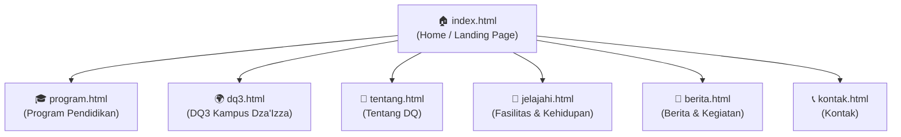
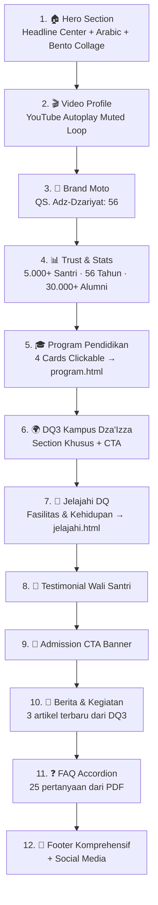

# Tahap 1 (Revisi v2): Strategic Planning — Website Daar el-Qolam
## Full Multi-Page Website · Home sebagai Landing Page

> [!NOTE]
> Dokumen ini sudah diperbarui berdasarkan **seluruh feedback** Anda. Semua perubahan ditandai dengan ✅.

---

## A. Perubahan Besar dari Versi Sebelumnya

| # | Feedback Anda | Status |
|---|---|---|
| 1 | Proyek berubah menjadi **website multi-page**, bukan landing page | ✅ |
| 2 | Hapus **Virtual Tour** dari seluruh navigasi | ✅ |
| 3 | **Tidak perlu utility bar** di atas navbar | ✅ |
| 4 | Tambah **video YouTube autoplay** (muted, loop, tanpa judul) | ✅ |
| 5 | Trust & Stats ditempatkan **setelah ayat visi** (Brand Moto) | ✅ |
| 6 | Program cards **clickable** → link ke page program | ✅ |
| 7 | Tambah section **Berita & Kegiatan** dari sumber DQ3 | ✅ |
| 8 | Tambah **FAQ accordion** sebelum footer (25 FAQ dari PDF) | ✅ |
| 9 | DQ3 punya **section khusus** + CTA ke website & PSB-nya | ✅ |
| 10 | Jelajahi DQ → link ke **page artikel** (sumber: DQ3 blog/berita) | ✅ |
| 11 | **Social media** di footer (YT, IG ×3, TikTok) | ✅ |
| 12 | Testimonial pakai **placeholder realistis** | ✅ |
| 13 | Gambar bento collage **dipertahankan** (file lokal) | ✅ |

---

## B. Arsitektur Multi-Page — Sitemap

> [!IMPORTANT]
> **Penjelasan untuk non-developer:** Multi-page artinya website akan terdiri dari beberapa file HTML yang saling terhubung. Setiap halaman berbagi komponen yang sama (navbar, footer) sehingga terlihat konsisten. Navigasi antar halaman menggunakan link biasa (`<a href="program.html">`). **Tidak perlu server atau framework khusus** — cukup buka file HTML di browser.



### Daftar File yang Akan Dibuat

| File | Halaman | Konten Utama |
|---|---|---|
| `index.html` | **Home (Landing)** | Hero, Video, Brand Moto, Trust & Stats, Program preview, DQ3 CTA, Jelajahi, Testimonial, Admission CTA, FAQ, Footer |
| `program.html` | **Program Pendidikan** | Detail 4 program (Reguler, Excellent, International, Dirasah) |
| `dq3.html` | **DQ3 Kampus Dza'Izza** | Profil DQ3, program, CTA ke [daarelqolam3.sch.id](https://www.daarelqolam3.sch.id/) & [PSB DQ3](https://psb.daarelqolam3.sch.id/) |
| `tentang.html` | **Tentang DQ** | Sejarah, Visi & Misi, Pimpinan |
| `jelajahi.html` | **Jelajahi** | Fasilitas, Kehidupan Islami, Asrama, Ekstrakurikuler |
| `berita.html` | **Berita & Kegiatan** | Artikel dari DQ3 blog/berita, liputan media |
| `kontak.html` | **Kontak** | Alamat, maps, WhatsApp, formulir |
| `components/` | **Shared** | `navbar.html`, `footer.html` (di-include via JS) |

---

## C. Navigasi (Mega-Menu) — Tanpa Utility Bar

```
┌──────────────────────────────────────────────────────────────────┐
│ [Logo DQ]  Tentang DQ ▾  Program ▾  Jelajahi ▾  Berita  Kontak │
│                                        [🔴 Pendaftaran Dibuka]  │
│                                        [Daftar Sekarang]        │
└──────────────────────────────────────────────────────────────────┘
```

| Menu | Dropdown Items |
|---|---|
| **Tentang DQ** | Profil Pesantren, Visi & Misi, Pimpinan, Sejarah |
| **Program** | Program Reguler (DQ Pusat), Excellent Class (DQ 2), International (DQ 3), Dirasah Islamiyyah (DQ 4) |
| **Jelajahi** | Fasilitas, Kehidupan Islami, Ekstrakurikuler, Kehidupan Asrama |
| **Berita** | Langsung ke `berita.html` (tanpa dropdown) |
| **Kontak** | Langsung ke `kontak.html` |

- **Tidak ada Virtual Tour**
- **Tidak ada utility bar**
- CTA "Daftar Sekarang" + badge pulsing tetap di kanan

---

## D. Home Page (index.html) — Content Flow



---

## E. Detail Teknis Per-Section

### 1. Hero Section — Center Align, Perbesar

```diff
- Layout grid 2 kolom (teks kiri, foto kanan)
+ Layout stacked vertikal, semua center align

- Headline: text-4xl sm:text-5xl lg:text-[56px]
+ Headline: text-5xl sm:text-6xl lg:text-7xl xl:text-8xl text-center

- Arabic: text-xl text-right
+ Arabic: text-2xl sm:text-3xl lg:text-4xl text-center

- Terjemahan: text-xs
+ Terjemahan: text-sm sm:text-base text-center

- Bento collage: kolom kanan, h-[420px] lg:h-[520px]
+ Bento collage: di bawah teks, full-width max-w-6xl mx-auto, h-[480px] lg:h-[600px]
```

- Trust Pills & Stats: **dihapus dari Hero** → pindah ke section #4
- Floating enrollment card: **dipertahankan** + tambah `data-enrollment-percent` (API-ready)
- Floating rating card: **dipindah** ke Testimonial section

### 2. Video Profile Section (BARU)

```html
<!-- YouTube embed: autoplay, muted, loop, no controls/title -->
<section class="w-full">
  <div class="aspect-video w-full max-w-7xl mx-auto">
    <iframe src="https://www.youtube.com/embed/5nbIMNyNhTI?autoplay=1&mute=1&loop=1
      &playlist=5nbIMNyNhTI&controls=0&showinfo=0&modestbranding=1&rel=0"
      class="w-full h-full" frameborder="0" allow="autoplay" allowfullscreen>
    </iframe>
  </div>
</section>
```

- Video ID: `5nbIMNyNhTI`
- Parameters: `autoplay=1`, `mute=1`, `loop=1`, `controls=0`, `showinfo=0`
- `playlist=5nbIMNyNhTI` diperlukan agar loop berfungsi di YouTube embed

### 3. Brand Moto + 4. Trust & Stats

- Brand Moto: **sama seperti plan v1** (perbesar teks, fix WCAG `white/60` → `white/90`)
- Trust & Stats: Ditempatkan **tepat setelah Brand Moto** sebagai section terpisah
- Angka statistik: `text-5xl lg:text-7xl` — masif dan impactful

### 5. Program Pendidikan — Cards Clickable

Semua card dibungkus `<a href="program.html#reguler">` (atau anchor lain sesuai program):

| Card | Sub-heading | Heading | Link |
|---|---|---|---|
| 1 | Daar el-Qolam Pusat | Program Reguler | `program.html#reguler` |
| 2 | Daar el-Qolam 2 | Program Excellent Class | `program.html#excellent` |
| 3 | Daar el-Qolam 3 · Kampus Dza'Izza | Program International | `dq3.html` |
| 4 | Daar el-Qolam 4 | Program Dirasah Islamiyyah | `program.html#dirasah` |

### 6. DQ3 Kampus Dza'Izza — Section Khusus (BARU)

Section CTA premium dengan tagline DQ3: *"Go Global, Be a Global Player"* + *"Pesantren Beyond Pesantren"*

```
┌────────────────────────────────────────────────────────┐
│  bg-gradient (dq-green → dark)                         │
│                                                        │
│  "Daar el-Qolam 3 · Kampus Dza'Izza"                 │
│  "Pesantren Beyond Pesantren"                          │
│                                                        │
│  3 highlight: Kerjasama Internasional · Bilingual ·    │
│  University Center (Az-Zaitunah Tunisia)               │
│                                                        │
│  [Kunjungi Website DQ3 →]  [Daftar PSB DQ3 →]        │
│  daarelqolam3.sch.id       psb.daarelqolam3.sch.id    │
└────────────────────────────────────────────────────────┘
```

### 7. Jelajahi DQ

Preview cards (Fasilitas, Kehidupan Islami, Asrama, Ekstrakurikuler) → link ke `jelajahi.html`. Konten halaman jelajahi diambil dari:
- **DQ3 blog**: Artikel tentang kehidupan pesantren
- **DQ3 berita**: Event dan kegiatan
- **Instagram DQ** (`@daarelqolam`, `@dzaizza_official`): Referensi visual

### 8. Testimonial — Placeholder Realistis

3 testimonial cards berdasarkan konteks DQ yang nyata:

| # | Nama (Placeholder) | Kutipan |
|---|---|---|
| 1 | Bapak Ahmad Fauzi, Wali Santri DQ Pusat | *"Anak saya berkembang pesat dalam hafalan Qur'an dan bahasa Arab..."* |
| 2 | Ibu Siti Nurhaliza, Wali Santriwati DQ 2 | *"Excellent Class memberikan keseimbangan antara ilmu agama dan sains..."* |
| 3 | Bapak Reza Pratama, Alumni DQ 3 | *"Kerjasama internasional DQ3 dengan Az-Zaitunah Tunisia membuka jalan saya..."* |

### 9–10. Admission CTA + Berita & Kegiatan

**Berita**: 3 artikel terbaru dari DQ3 berita (sudah di-scrape):
1. *"Tingkatkan Kualitas Perpustakaan, Dza'Izza Perkuat Kolaborasi Literasi"*
2. *"Santri Daar el-Qolam 3 Mengikuti Seleksi Paskibraka Kabupaten Tangerang"*
3. *"Dua Santriwati Tembus Seleksi Nasional OPSI 2026"*

Masing-masing link ke sumber asli di `daarelqolam3.sch.id/news/...`

### 11. FAQ Accordion (BARU) — 25 Pertanyaan

Data dari PDF `faq_sanbar_2025.pdf` (sudah diekstrak). Contoh 5 teratas:

| # | Pertanyaan |
|---|---|
| 1 | Apa Perbedaan Daar el-Qolam Pusat, 2, 3 dan 4? |
| 2 | Bagaimana muatan kurikulum di Daar el-Qolam? |
| 3 | Bagaimana tahapan menjadi santri Pondok Pesantren Daar el-Qolam? |
| 4 | Bagaimana cara melakukan pendaftaran? |
| 5 | Apa saja materi yang diujikan saat tes seleksi masuk? |

**Implementasi**: Accordion dengan `<details><summary>` atau JS toggle. Styling:
- Container: `bg-white rounded-2xl border border-dq-green/10`
- Question: `font-semibold text-dq-charcoal cursor-pointer py-4 px-6`
- Answer: `text-dq-warm-gray text-sm px-6 pb-4`
- Animasi expand: `transition-all duration-300`

### 12. Footer Komprehensif

```
┌──────────────────────────────────────────────────────────┐
│  bg-dq-green-dk                                          │
│                                                          │
│  [Logo] Daar el-Qolam    Program         Jelajahi       │
│  Tagline pesantren        • Reguler       • Fasilitas    │
│                           • Excellent     • Kehidupan    │
│  Social Media:            • International • Asrama       │
│  📺 YouTube @ElQolam     • Dirasah       • Ekskul       │
│  📸 @daarelqolam                                        │
│  📸 @dzaizza_official    Kontak          Pendaftaran     │
│  📸 @darqomusic          • Alamat        • PSB DQ       │
│  🎵 TikTok @ponpes...   • Telp          • PSB DQ3      │
│                           • WhatsApp     • Download      │
│                           • Email          E-Brochure    │
│                                                          │
│  ─────────────────────────────────────────────────────── │
│  © 2026 Pondok Pesantren Daar el-Qolam                  │
└──────────────────────────────────────────────────────────┘
```

**Social Media Links:**
- YouTube: `https://www.youtube.com/@ElQolam/videos`
- Instagram DQ: `https://www.instagram.com/daarelqolam/`
- Instagram DQ3: `https://www.instagram.com/dzaizza_official/`
- Instagram Darqo Music: `https://www.instagram.com/darqomusic/`
- TikTok: `https://www.tiktok.com/@ponpesdaarelqolam`

---

## F. Pendekatan Teknis (Multi-Page)

> [!IMPORTANT]
> **Penjelasan untuk Anda sebagai designer:** Saya akan membuat website ini menggunakan **file HTML biasa** (bukan framework rumit). Setiap halaman adalah satu file `.html`. Navbar dan footer yang sama di-load ke setiap halaman menggunakan sedikit JavaScript. Cara membukanya: **double-click file `index.html`** di browser. Tidak perlu install apa-apa.

### Struktur Folder

```
001_DQ Rebranding/
├── index.html          ← Home / Landing Page
├── program.html        ← Program Pendidikan
├── dq3.html            ← DQ3 Kampus Dza'Izza
├── tentang.html        ← Tentang DQ
├── jelajahi.html       ← Jelajahi (Fasilitas dll)
├── berita.html         ← Berita & Kegiatan
├── kontak.html         ← Kontak
├── css/
│   └── style.css       ← Design system & semua styling
├── js/
│   └── main.js         ← Shared logic (navbar, footer, FAQ, animations)
├── components/
│   ├── navbar.html     ← Komponen navbar (di-include via JS)
│   └── footer.html     ← Komponen footer (di-include via JS)
├── Logo Darqo.png      ← Existing
├── BP3A8852.jpg        ← Existing (bento collage)
├── DJI_0849.jpg        ← Existing
├── DJI_0866 (2)-2.jpg  ← Existing
└── upacaradq2.jpg      ← Existing
```

### Teknologi
- **HTML5** + **Tailwind CSS (CDN)** — sama seperti prototype saat ini
- **Vanilla JavaScript** — untuk include navbar/footer, mega-menu toggle, FAQ accordion, scroll animations
- **Tidak perlu Node.js, npm, atau server** — langsung buka di browser

---

## G. Execution Plan (Urutan Kerja)

| Phase | Files | Estimasi |
|---|---|---|
| **Phase 1** | `css/style.css`, `js/main.js`, `components/navbar.html`, `components/footer.html` | Fondasi |
| **Phase 2** | `index.html` — Home/Landing Page lengkap | Core page |
| **Phase 3** | `program.html`, `dq3.html` | Program pages |
| **Phase 4** | `tentang.html`, `jelajahi.html` | Info pages |
| **Phase 5** | `berita.html`, `kontak.html` | Content pages |
| **Phase 6** | Testing, responsiveness, polish | QA |

---

## Open Questions (Terakhir)

> [!IMPORTANT]
> **Ornamen garis simetris** pada sub-judul Program: Apakah ornamen `gold-line` yang saat ini hanya di kiri teks juga ingin diterapkan ke section header lainnya (Testimonial, FAQ, dll), atau **hanya di Program**?

> [!NOTE]
> **Konten halaman sekunder** (tentang.html, jelajahi.html, dll): Untuk versi pertama, saya akan menggunakan konten placeholder yang relevan dari data DQ3 yang sudah di-scrape. Konten bisa diperbarui nanti.

---

**Apakah roadmap revisi v2 ini sudah sesuai, dan bolehkah saya mulai membangun website-nya?**
